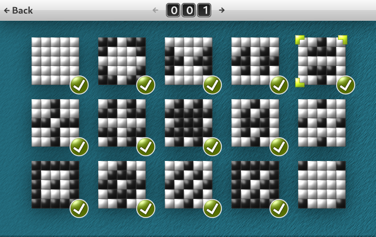
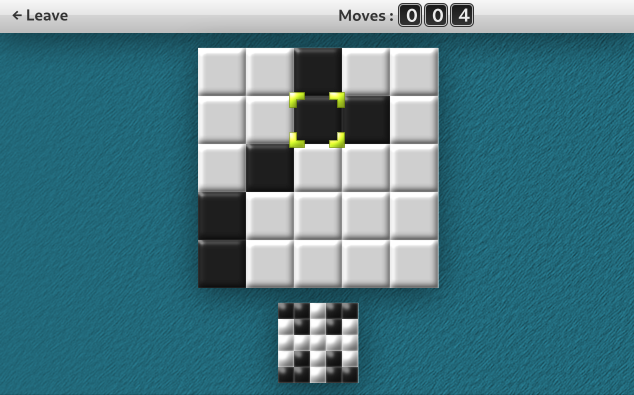

Simple reimplementation of 5x5 game found in GNU Emacs using C and Raylib.

# How to install (and compile)?

Follow instructions in INSTALL file.  You need only first 11 lines
of that GNU autogenerated prose to understand what to do.

To compile the project, you need to have Raylib (https://www.raylib.com/)
installed on your system.  Raylib files are found on the system by using
pkg-config.

Note, before you run the game, you should INSTALL it using `make install`.

# How to contribute?

Found a bug --- make a bug report;
Want more features --- make a feature request;
Want to see your code here --- fork and do it.

There are no documentation, there are no code guidelines, there are
no tests, there are nothing.

To modify game graphics you need to have Inkscape installed.  Inkscape
project with all game assets is located in assets/layout.svg file

# How to cross-compile for Windows/NT

Add `--host=x86_64-w64-mingw32` while configuring (change x86_64 to whatever
cpu architecture you want), then compile as usual.  After that, find all
required dlls and put it into some directory included in dll search paths 
(same directory as exe would be good enough).

# How to run (and compile) on Windows/NT?

1. Install msys2
2. Install raylib, gcc and pkg-config (mingw versions)
3. Compile as usual
